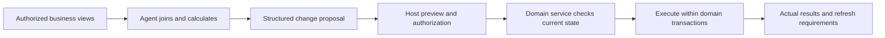

# Make existing business systems a working environment for coding agents

> **Let the model compose operations in code, while the backend retains control of rules and writes.**

[中文](README.zh-CN.md) · [Run the example](#2-run-the-example-inventory-reconciliation) · Engineering practice from
[Foundax](https://foundax.com)

An established software company already has databases, APIs, domain services, and authorization.
When adding agents to CRM, ERP, commerce, or marketing software, it faces a concrete question:
**how should these existing assets become a business environment that an agent can understand, explore, and operate?**

This project draws on commerce engineering at Foundax and shares three connected problems:

- **Understanding the business:** expose authorized data, entity relationships, field semantics, and operation contracts
  as readable context.
- **Continuing as data changes:** manage source, business snapshots, and session files separately,
  refreshing data through dependency versions.
- **Applying real changes:** let the model generate proposals, then have the host and existing domain services
  validate and execute them.

## 1. Start with a business goal

A merchant might ask:

> Prepare a weekend campaign: find products with enough stock, fill in missing English and Chinese descriptions,
> and set suitable discounts. Let me review the changes first.

The agent must understand how available inventory is calculated, join products with variants and localized content,
and respect promotion rules. Other users may change inventory or edit products during the task.
The data at approval time may differ from the data used to generate the proposal.

| Business question | Required contract |
| --- | --- |
| Which products belong to this task? | Selected resources intersected with current permissions |
| Does an inventory row represent a product or a variant? | Row granularity, join keys, units, and `available = onHand - reserved` |
| Does this dataset cover all products? | Snapshot time, filters, and completeness metadata |
| What if another user changes inventory? | Refresh rules and version-conflict handling at write time |
| What can the model decide? | Task-specific selection and calculation; domain services retain business constraints |

Similar problems appear in CRM customers and interactions, ERP materials and purchasing plans,
and marketing campaigns and attribution data.
The project shares an integration approach for existing business systems; the example uses synthetic products and stocktakes.

### Practice, design, and repository implementation

| Layer | Contents |
| --- | --- |
| Foundax internal practice | Authorized business views, source and data snapshots, isolated execution, host-side domain writes |
| Public engineering design | Data contracts, cache reuse, invalidation, isolation, and consistency requirements in prose and pseudocode |
| Runnable repository | Local JSON data, a reconciliation script, structured proposals, an in-memory domain service, and tests |

The demo uses ordinary local directories and Node processes. It contains no model calls, sandbox runtime,
snapshot cache, or automatic refresh implementation.

## 2. Run the example: inventory reconciliation

Requires **Node.js 22+**, with no third-party dependencies, model API key, or database.
From the repository root, run:

```sh
npm run demo
npm run apply-demo
```

`npm run demo` prepares `.demo/workspace` and runs a hand-written reference program.
It reads product and stocktake data and generates a proposal:

```json
[
  { "id": "mug", "expectedRevision": 3, "set": { "onHand": 5 } },
  { "id": "vase", "expectedRevision": 7, "set": { "onHand": 1, "status": "paused" } }
]
```

The proposal is written to `.demo/workspace/output/changes.json`.
`npm run apply-demo` represents the host execution stage: it reads the proposal and checks shop scope,
writable fields, reserved units, and record versions. Valid changes update the in-memory data and print the result.
Each invocation starts from the same synthetic fixture; updated state remains local to that process.

This example focuses on reconciliation. The multilingual content and promotion task above illustrates the wider business context.

### Inspect the business boundaries in code

| Case | Example behavior |
| --- | --- |
| Export product data | Return business fields for the current shop, excluding unit cost |
| Submit a product ID from another shop | Reject the change |
| Try to change `reserved`, unit cost, or shop scope | Reject the change |
| Count fewer units than are already reserved | Reject the change; resolve the discrepancy first |
| Submit an outdated `expectedRevision` | Reject the proposal; read fresh data and generate a new one |
| Include an invalid change in a batch | Reject the batch and retain the original in-memory data |

See the [domain service](src/catalog-service.mjs), [reconciliation script](examples/reconcile-stocktake.mjs),
[data contract](workspace/WORKSPACE.md), and [tests](test/workspace.test.mjs).
The field projection demonstrates a read contract; local processes still have the operating-system user's file permissions.

### Try your own coding agent

```sh
# Reset generated files; this overwrites the example program and data
npm run prepare-demo

# Open .demo/workspace in your coding agent
# Ask it to read WORKSPACE.md and TASK.md, then write task.mjs
# Review the generated program before running it
npm run propose-demo

# Validate and apply the proposal through the host
npm run apply-demo
```

Production integration replaces the fixed shop scope and in-memory updates with real identity-based authorization
and domain-service transactions, and runs generated code in an independently isolated execution environment.

## 3. Organize existing business assets for exploration

### 3.1 Read contracts: from database structure to business meaning

A raw schema describes storage. The agent also needs row semantics, join paths, calculation rules,
and permitted operations. The host uses existing domain read services to authorize and project data,
then exposes business views such as:

```text
products(id, name, ...)
variants(id, productId -> products.id, ...)
inventory(variantId -> variants.id, onHand, reserved)
product_content(productId -> products.id, locale, title, description)
```

These views are illustrative. A read contract also describes:

- **Entities and relationships:** primary and foreign keys, row granularity, and join paths.
- **Field semantics:** types, units, enums, and derived values such as available inventory.
- **Visibility:** tenant, user permissions, selected resources, and partial-export filters.
- **Change boundaries:** fields that may be proposed for modification and constraints enforced by the backend.

Start with a catalog and relationship index, then read relevant tables and source as needed.
Task filters can narrow an authorized view; expanding the selection requires renewed host authorization checks.
Use consistent business field names in read views and proposals to reduce mapping between interfaces.

### 3.2 Data lifecycles: reduce database reads while retaining task state

Tasks repeatedly filter, join, and calculate over data.
Preparing authorized JSON or local SQLite moves exploration of covered data into the execution environment;
initial exports, supplemental queries, and refreshes still pass through the host.

Source, business data, and session files change for different reasons.
The reference design separates them into four logical mounts:

| Mount | Contents | Lifecycle |
| --- | --- | --- |
| `/repo` | Authorized source, schemas, contracts | Versioned read-only artifacts shared under the same source visibility |
| `/data` | Authorized business data | Cached by scope; affected domains refresh by dependency |
| `/work` | Scripts and intermediate results | Session-specific; retained when data refreshes |
| `/outputs` | Proposals and deliverables | Read, validated, and executed by the host |

For example, after a merchant approves a stock correction, an agent preparing a campaign should refresh
the affected inventory view before continuing with its retained scripts.
Each command reads a fixed snapshot version; data switches between commands.

The [snapshot lifecycle design](docs/workspace-lifecycle.md) details cache keys, task projections,
dependency watermarks, concurrent builds, and consistency conditions.
These mounts and caches are reference designs; the demo uses the ordinary local directory described in Section 2.

### 3.3 Write contracts: task logic and business constraints

Selecting candidate products or proposing that an out-of-stock item be paused is task logic the model can compose in code.
Domain services enforce shop ownership, writable fields, inventory constraints, record versions, and promotion rules.



The host accepts explicit business changes without granting arbitrary database access.
`expectedRevision` binds a proposal to the record version it used.
On a conflict, read the relevant data again and recalculate; changing only the version number does not make
an old proposal valid.

Finishing a calculation, approving a proposal, and completing a business write are separate stages.
Report outcomes from the domain service's actual result.
Cross-domain batches also require explicit transaction, partial-success, and retry semantics.
Charges, refunds, and notifications continue through business commands with explicit authorization.

## 4. Trade-offs and execution frameworks

Use tools directly when an existing business API expresses the task well, and workflows when paths are stable.
Code execution with a persistent environment helps compose capabilities when tasks require dynamic joins,
batch calculations, and intermediate state. These approaches can coexist;
coding agents also use tool calling to read files and run commands.

Snapshots introduce export, storage, permission-change, and freshness-management costs.
They support exploration and calculation; final writes still require current-state validation by domain services.
See [Section 6 of the engineering design](docs/workspace-lifecycle.md#6-performance-trade-offs-and-observability)
for costs and observability.

The [OpenHands Software Agent SDK](https://docs.openhands.dev/sdk/arch/overview) provides general components
for agent loops, tools, conversations, and execution environments.
This project addresses data and operation contracts for existing business systems,
for teams using an established agent framework or their own runtime.
The current example demonstrates these contracts through local scripts and includes no framework-specific adapter.

Related approaches:

- Anthropic: [Building effective agents](https://www.anthropic.com/research/building-effective-agents).
- Anthropic: [Code execution with MCP](https://www.anthropic.com/research/code-execution-with-mcp).
- Cloudflare: [Code Mode](https://developers.cloudflare.com/agents/tools/codemode/).

## 5. Contributing and discussing business integration

We welcome designs and cases grounded in specific business problems:

- **Business data contracts:** represent CRM relationships, ERP units, or marketing attribution semantics
  so agents can join and calculate correctly.
- **Changing state and conflicts:** refresh data, reject stale proposals, and preserve useful work
  when state changes during exploration, approval, or continuation.
- **Domain-service integration:** reuse permissions, validation, and transaction boundaries;
  specify partial-success and retry behavior for batches.
- **Engineering trade-offs:** use synthetic cases to examine snapshot granularity, database load,
  preparation latency, and task quality.

For a design discussion, include the business goal, data relationships, constraints, and a concrete failure scenario.
See [CONTRIBUTING.md](CONTRIBUTING.md).
Discuss your integration through Issues or Discussions, or contact the Foundax team at
[contact@novariseintl.com](mailto:contact@novariseintl.com) to exchange business use cases and engineering trade-offs.

## Deployment responsibilities and license

- **Models and data:** the project provides engineering designs and synthetic examples.
  Implementers connecting real models or production data must assess and meet applicable requirements for model deployment,
  data security, privacy, and cross-border transfers in their location and the jurisdictions involved.
- **License:** code and documentation use the [MIT License](LICENSE).
